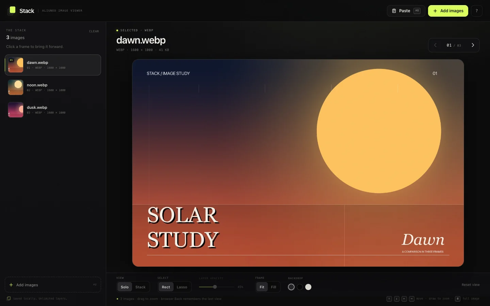
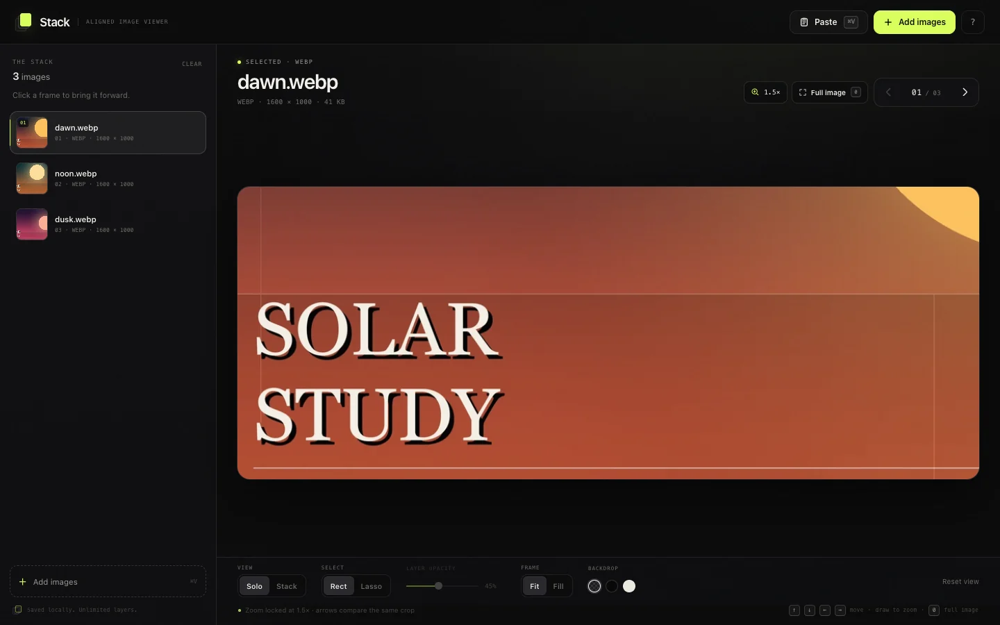

# Stack

Compare unlimited image variations in one fixed frame. Paste with `⌘V`, flip through the stack, and keep the same rectangle or freehand lasso crop on every image.

[Live demo](https://ahmet-dedeler.github.io/image-stack/) · [MIT license](LICENSE)



I made this for comparing AI image generations and design iterations. Most image comparison tools are built for two images, or they make you crop each image again. Stack is for 2, 20, or 50 versions, and keeps one crop across all of them.

## What it does

- Add unlimited images with the file picker, drag and drop, or `⌘V`.
- WebP, PNG, JPG, AVIF, GIF, SVG, and anything else your browser can decode.
- Solo view for flipping, Stack view for overlaying layers with adjustable opacity.
- Rect crop by default. Freehand lasso if you want something less rectangular.
- The crop stays locked while you switch images, so you only see the same region changing.
- The viewer resizes to the crop instead of putting checkerboard padding around it.
- Full image button and `0` / `Esc` to get back.
- Arrow keys, browser Back, and local autosave.



## Why another image comparison tool?

Most comparison tools are made for before/after pairs. This one is for a stack of variants that share the same dimensions: AI generations, renders, screenshot diffs, design options. You paste everything in, click through, and keep your place.

The whole app is client-side. Images are saved in IndexedDB on your machine, not uploaded anywhere.

## Run it

Needs Node 20+ and pnpm.

```bash
git clone https://github.com/Ahmet-Dedeler/image-stack.git
cd image-stack
pnpm install
pnpm dev
```

Open [http://localhost:5173](http://localhost:5173).

Production build:

```bash
pnpm build
pnpm preview
```

## Shortcuts

| Key | Action |
| --- | --- |
| `←` `→` `↑` `↓` | Previous / next image |
| `⌘V` | Paste images from the clipboard |
| Drag on the image | Select a rectangle or lasso region |
| `0` / `Esc` | Back to the full image |
| `1`–`9` | Jump to an image |
| `O` | Toggle Solo / Stack view |
| `R` | Reset the view |
| `?` | Show all shortcuts |

## Formats and browser support

Stack reads through the browser's image decoder, so support depends on the browser. WebP, PNG, JPEG, GIF, AVIF, SVG, and BMP work in current versions of Chrome, Safari, and Firefox. HEIC support depends on the browser.

Pasting screenshots and copied image files works on macOS. The Paste button uses the Clipboard API where available, and `⌘V` works as the fallback.

## How it works

- Vite + TypeScript, no backend.
- Images and UI state live in IndexedDB, so reloads and app updates don't wipe your stack.
- Rectangle and lasso crops are stored as normalized points, so the same crop maps across every image.
- The frame and crop use the selected image's own aspect ratio. No stretching.

## License

MIT. Use it, fork it, change it.
